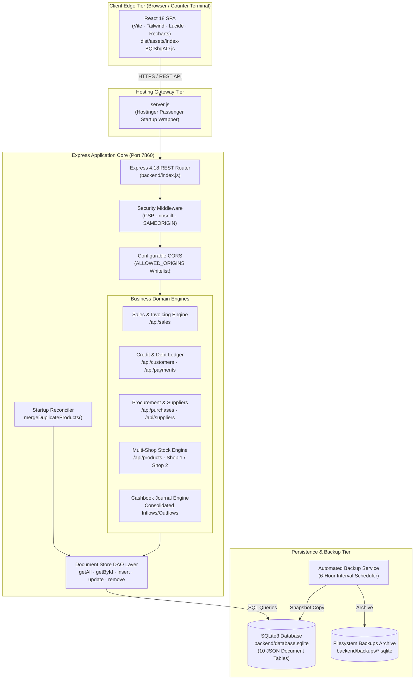

# System Architecture Document
## Aura Furniture Management & POS System (Shan-e-Aziz POS)

**Version:** 1.2  
**Last Updated:** 2026-09-21  
**Architecture Style:** Client-Server Monolith / Embedded Document Store  
**Runtime:** Node.js v20+ / Express 4.18.2  
**Database:** SQLite3 (JSON Document Store Pattern)  
**Frontend:** React 18 / Vite / TailwindCSS  
**Interactive Visual Artifact:** [architecture.html](file:///e:/Softwares/Aura%20Inventory%20nodejs/architecture.html) (Built via Archify)

---

## 1. High-Level Architecture Overview

The Aura Furniture Management System utilizes a single-process, local-first monolithic client-server architecture designed for high reliability, minimal external dependencies, and instant local execution on counter terminals as well as cloud-hosted environments (e.g., Hostinger Node.js Passenger hosting).



> [!TIP]
> An interactive visual architecture diagram with layer tracing, relationship inspection, and dark/light mode is available in [architecture.html](file:///e:/Softwares/Aura%20Inventory%20nodejs/architecture.html).

---

## 2. System Tiers & Component Details

### 2.1 Presentation Tier (Frontend React SPA)
* **Location:** `dist/` (Bundled via Vite)
* **Core Technologies:** React 18, TailwindCSS, Lucide React (icons), Recharts (data visualizations), HTML5 Canvas (`html2canvas`).
* **Deployment Pattern:** Static asset distribution directly through Express `express.static('dist')` with a catch-all route `GET *` forwarding unhandled paths to `dist/index.html` for client-side HTML5 history routing.
* **Key Subsystems:**
  * **POS Counter (`x === "Sale"`):** Real-time cart calculations, barcode/manual product search, instant stock verification, customer credit validations.
  * **Cashbook View (`qee` component):** Unified chronologically sorted transaction journal with filtering by type, shop (`shop-1`, `shop-2`), and Pakistani Time Zone (`Asia/Karachi` / UTC+5) date grouping (`Today`, `Yesterday`, `This Week`, `This Month`, `Specific Date`). Purchases record upfront cash via `initialPaid`, and vendor payments appear as dedicated `Supplier Payment` rows.
  * **Settings & Transaction Management (`Hee` component):** Automated backup selection dropdown, one-click manual backup download, database switch confirmation modal, administrative reset triggers, and live **Transaction Management & Void** panel featuring real-time multi-field search and one-click ACID reversal buttons (`DELETE /api/sales/:id`, `DELETE /api/purchases/:id`, `DELETE /api/supplier-payments/:id`, `DELETE /api/payments/:id`).
  * **Supplier Ledger View:** Balance tracking, procurement history, and locked payment buttons when supplier dues reach zero.

### 2.2 Entry Gateway Tier (`server.js`)
* **Purpose:** Hostinger cPanel Node.js hosting environments utilize Phusion Passenger, which strictly requires a startup script located at the repository root named `server.js` or `app.js`.
* **Implementation:** `server.js` functions as a minimal bridge that invokes `require('./backend/index.js')`, binding the Express application cleanly into Hostinger's Passenger runtime.

### 2.3 Express Application Core (`backend/index.js`)
The backend is an Express 4.18.2 monolithic server listening on `PORT` (default `7860`).

```
Request Pipeline:
  HTTP Request 
    ▼
  Security Headers Middleware
    ▼
  Configurable CORS Middleware
    ▼
  BodyParser JSON Middleware (10MB limit)
    ▼
  Static Asset Engine (dist/)
    ▼
  HTTP Request Logger
    ▼
  REST Route Controllers (/api/*)
    ▼
  Document Store DAO (SQLite3)
```

#### Middleware Pipeline
1. **Security Headers Middleware:** Injects defensive HTTP response headers on every transaction:
   * `X-Content-Type-Options: nosniff` (mitigates MIME-type sniffing)
   * `X-Frame-Options: SAMEORIGIN` (prevents clickjacking in cross-origin iframes)
   * `X-XSS-Protection: 1; mode=block`
   * `Referrer-Policy: strict-origin-when-cross-origin`
   * `Content-Security-Policy: default-src 'self' 'unsafe-inline' 'unsafe-eval' data: blob:; img-src 'self' data: blob:; connect-src 'self' ws: wss: http: https:;`
2. **Configurable CORS Middleware:** Validates the `Origin` header against `process.env.ALLOWED_ORIGINS` (comma-delimited). Allows null/local origin requests (such as curl, mobile, or direct workstation browsing).
3. **Body Parser:** Configured with `limit: '10mb'` to support bulk inventory imports, base64 receipt rendering, and invoice payloads.
4. **Request Logger:** Simple timestamped logger `[ISO-TIMESTAMP] METHOD URL`.

---

## 3. Data Access Layer (DAO) & Persistence

### 3.1 Document Store Pattern over SQLite3
Rather than rigid relational tables with strict migration scripts, the application adopts a **JSON Document-Store pattern** over SQLite3. This provides NoSQL-like flexibility for rapidly evolving product attributes while retaining the durability and zero-config portability of a single-file SQLite database.

#### Schema Definition
```sql
CREATE TABLE products (id TEXT PRIMARY KEY, data TEXT);
CREATE TABLE customers (id TEXT PRIMARY KEY, data TEXT);
CREATE TABLE payments (id TEXT PRIMARY KEY, data TEXT);
CREATE TABLE sales (id TEXT PRIMARY KEY, data TEXT);
CREATE TABLE suppliers (id TEXT PRIMARY KEY, data TEXT);
CREATE TABLE purchases (id TEXT PRIMARY KEY, data TEXT);
CREATE TABLE supplierPayments (id TEXT PRIMARY KEY, data TEXT);
CREATE TABLE expenses (id TEXT PRIMARY KEY, data TEXT);
CREATE TABLE stockTransfers (id TEXT PRIMARY KEY, data TEXT);
CREATE TABLE counters (id TEXT PRIMARY KEY, value INTEGER);
```

### 3.2 DAO Primitives
The DAO exposes clean Promise-based asynchronous primitives:
* `getAll(table)`: Executes `SELECT id, data FROM <table>`, parses JSON strings into objects, and returns array `[{ id, ...data }]`.
* `getById(table, id)`: Executes `SELECT data FROM <table> WHERE id = ?`.
* `insert(table, id, data)`: Strips any conflicting `id` from the payload and writes stringified JSON to `INSERT INTO <table> VALUES (?, ?)`.
* `update(table, id, data)`: Fetches existing document, cleans incoming undefined keys using `stripUndefined(data)`, merges fields `{ ...existing, ...cleanData }`, and updates the table row.
* `remove(table, id)`: Executes `DELETE FROM <table> WHERE id = ?`.

### 3.3 The `stripUndefined()` Guard
```javascript
const stripUndefined = (obj) => {
    if (!obj || typeof obj !== 'object') return obj;
    Object.keys(obj).forEach(key => {
        if (obj[key] === undefined) {
            delete obj[key];
        } else if (obj[key] !== null && typeof obj[key] === 'object') {
            stripUndefined(obj[key]);
        }
    });
    return obj;
};
```
*Purpose:* When React updates an existing document, undefined fields in the request body would otherwise overwrite existing database properties (such as `createdAt` or historical metadata). `stripUndefined` guarantees preservation of untouched fields.

### 3.4 Startup Product Reconciler (`mergeDuplicateProducts`)
On every server initialization, `mergeDuplicateProducts()` executes:
1. Loads all products from `products`.
2. Groups entities by composite unique key: `${shopId}::${name.toLowerCase()}::${size.toLowerCase()}::${unit.toLowerCase()}`.
3. If duplicates exist:
   * Selects the primary entity (prioritizing items with positive stock and oldest `createdAt`).
   * Combines all duplicate quantities into the primary record: `combinedStock = sum(stock)`.
   * Updates the primary record with `combinedStock`.
   * Deletes all secondary duplicate rows from `products`.

### 3.5 Serialized ACID Transactions (`executeTransaction`) & Financial Precision
To ensure atomic consistency across multi-table writes without race conditions or SQLite database locking contention (`SQLITE_BUSY`), the backend implements a serialized asynchronous execution queue:
```javascript
const executeTransaction = async (operation) => {
    return new Promise((resolve, reject) => {
        transactionQueue = transactionQueue.then(async () => {
            await dbRun('BEGIN IMMEDIATE TRANSACTION');
            try {
                const res = await operation();
                await dbRun('COMMIT');
                resolve(res);
            } catch (err) {
                await dbRun('ROLLBACK');
                reject(err);
            }
        });
    });
};
```
* **Scope:** Governs sales (`POST /api/sales`), stock transfers (`POST /api/products/transfer`), customer settlements (`POST /api/payments`), procurement entries (`POST /api/purchases`), supplier payments (`POST /api/supplier-payments`), and transaction voiding (`DELETE /api/sales/:id`, `DELETE /api/purchases/:id`, `DELETE /api/supplier-payments/:id`, `DELETE /api/payments/:id`).
* **Financial Rounding:** All monetary operations pass through `roundMoney(val) = Math.round(Number(val) * 100) / 100` to prevent IEEE-754 floating-point drift across long-running accounts receivable and payable ledgers.

---

## 4. Disaster Recovery & Automated Backup Architecture

```
┌────────────────────────────────────────────────────────┐
│               Automated Backup Scheduler               │
│                                                        │
│  Trigger: Startup + setInterval(every 6 hours)         │
│                                                        │
│  [Check backend/backups/backup-YYYY-MM-DD.sqlite]      │
│                     │                                  │
│         Does it exist today?                           │
│           ├── YES: Skip (already saved)                │
│           └── NO:  Atomic fs.copyFileSync()            │
└────────────────────────────────────────────────────────┘
```

### 4.1 Backup Subsystem Specifications
1. **Archive Directory:** Stored at `backend/backups/` (or relative to `APP_DATA_PATH`). Directory is created recursively on startup if absent.
2. **Scheduled Backups:** `ensureDailyBackup()` runs at server launch and every 6 hours via `setInterval()`. It creates a daily baseline copy `backup-YYYY-MM-DD.sqlite`.
3. **Manual Snapshot API:** `POST /api/backups/create` generates timestamped snapshots: `backup-YYYY-MM-DD-HHMMSS.sqlite`.
4. **Download Endpoint:** `GET /api/backups/download/:filename` streams the selected snapshot to the client with sanitization preventing directory traversal (`path.basename()`).
5. **Safe Restoration Lifecycle:**
   ```
   Client POST /api/backups/restore { filename: "backup-2026-09-07.sqlite" }
                     │
                     ▼
   Verify requested backup file exists in backend/backups/
                     │
                     ▼
   Create emergency safety copy of current active database:
   "pre-restore-safety-YYYY-MM-DD-HHMMSS.sqlite"
                     │
                     ▼
   Safely copy target backup file over active database.sqlite
                     │
                     ▼
   Re-initialize SQLite connection: initDb()
                     │
                     ▼
   Return HTTP 200 { success: true } -> Client triggers window.location.reload()
   ```

---

## 5. REST API Catalog

| Method | Endpoint | Description | Request Body | Response | Security / Guard |
|---|---|---|---|---|---|
| `GET` | `/api/products` | Retrieve all inventory products | None | `Array<Product>` | Public |
| `POST` | `/api/products` | Create a new product | `{ name, category, size, unit, purchasePrice, salePrice, stock, shopId }` | `Product` (`201`) | Input validation |
| `PUT` | `/api/products/:id` | Update existing product details | Partial product object | Updated `Product` | Entity existence check |
| `DELETE` | `/api/products/:id` | Delete product by ID | None | `{ message }` | None |
| `POST` | `/api/products/transfer` | Inter-shop stock transfer | `{ sourceShopId, targetShopId, sourceProductId, quantity, note }` | Transfer record | Stock balance check |
| `GET` | `/api/stock-transfers` | List stock transfer history | None | `Array<StockTransfer>` | Public |
| `GET` | `/api/customers` | Retrieve customer directory | None | `Array<Customer>` | Public |
| `POST` | `/api/customers` | Create new customer | `{ name, phone, address, balance }` | `Customer` (`201`) | Duplicate phone check |
| `PUT` | `/api/customers/:id` | Update customer record | Partial customer object | Updated `Customer` | None |
| `DELETE` | `/api/customers/:id` | Remove customer | None | `{ message }` | None |
| `GET` | `/api/payments` | Retrieve customer payments | None | `Array<Payment>` | Public |
| `POST` | `/api/payments` | Record payment against credit | `{ customerId, saleId, amount, paymentMethod, date, note }` | `Payment` (`201`) | Customer balance update |
| `GET` | `/api/sales` | Retrieve all sales transactions | None | `Array<Sale>` | Public |
| `GET` | `/api/sales/next-invoice`| Generate next sequential invoice #| None | `{ invoiceNumber: number }` | Atomic counter increment |
| `POST` | `/api/sales` | Commit sale or return | `{ items, total, paidAmount, remainingAmount, paymentMethod, status, type, customerName, customerPhone, shopId }` | Created `Sale` (`201`) | Stock deduction, credit validation |
| `GET` | `/api/suppliers` | List all suppliers | None | `Array<Supplier>` | Public |
| `POST` | `/api/suppliers` | Create new supplier | `{ name, contactPerson, phone, address, balance }` | `Supplier` (`201`) | None |
| `PUT` | `/api/suppliers/:id` | Update supplier record | Partial supplier object | Updated `Supplier` | None |
| `DELETE` | `/api/suppliers/:id` | Delete supplier | None | `{ message }` | None |
| `GET` | `/api/purchases` | List procurement purchase orders | None | `Array<Purchase>` | Public |
| `POST` | `/api/purchases` | Create purchase & restock inventory| `{ supplierId, items, totalAmount, paidAmount, remainingAmount, shopId }` | `Purchase` (`201`) | Stock increment, supplier debt update |
| `GET` | `/api/supplier-payments`| List supplier payments | None | `Array<SupplierPayment>` | Public |
| `POST` | `/api/supplier-payments`| Record payment to supplier | `{ supplierId, amount, paymentMethod, shopId, note }` | `SupplierPayment` (`201`)| Balance deduction, $\le 0$ balance lock |
| `GET` | `/api/expenses` | List business expenses | None | `Array<Expense>` | Public |
| `POST` | `/api/expenses` | Record operating expense | `{ title, amount, category, paymentMethod, shopId, date }` | `Expense` (`201`) | None |
| `GET` | `/api/backups` | List all available backup files | None | `Array<{ filename, size, sizeFormatted, createdAt, label }>` | Public |
| `POST` | `/api/backups/create` | Trigger on-demand manual backup | None | `{ success, backup }` | None |
| `GET` | `/api/backups/download/:fn`| Download raw `.sqlite` backup | URL param `:filename` | Binary `.sqlite` download | Path traversal guard |
| `POST` | `/api/backups/restore` | Switch live DB to selected backup | `{ filename: string }` | `{ success: true }` | Safety snapshot guard |
| `POST` | `/api/reset` | Factory reset (truncate all tables)| Empty body + Auth header | `{ message: string }` | `ADMIN_RESET_TOKEN` + `ALLOW_DB_RESET` |
| `POST` | `/api/recalculate-balances`| Recalculate customer debt ledgers| None | `{ success: true, count }` | Mathematical journal reconciliation |

---

## 6. Security & Defense Architecture

### 6.1 Guarded Administrative Database Reset
To eliminate the catastrophic unauthenticated wipe vulnerability identified during security auditing, `POST /api/reset` requires two independent layers of protection:
```javascript
const adminToken = process.env.ADMIN_RESET_TOKEN;
const allowReset = process.env.ALLOW_DB_RESET === 'true';

app.post('/api/reset', async (req, res) => {
    if (!allowReset) {
        return res.status(403).json({ error: 'Database reset disabled in this environment.' });
    }
    const authHeader = req.headers['x-admin-token'] || req.headers['authorization'];
    if (!adminToken || authHeader !== adminToken) {
        return res.status(401).json({ error: 'Unauthorized: Invalid administrative token.' });
    }
    // Proceed with safety backup, followed by truncation...
});
```

### 6.2 Customer Credit Validation Guard
When sales are transacted under `Partial` or `Pending` status (leaving an unpaid balance), the system strictly guards against anonymous debtors:
* Generic placeholder names (`"Walk-in Customer"`, `""`) are blocked.
* Customer phone number is strictly required.
* Ensures every rupee of accounts receivable is mapped to a traceable debtor profile.

### 6.3 Zero-Balance Supplier Lock
To prevent negative debts and ledger corruption, UI buttons and backend handlers verify `supplier.balance > 0`. If a supplier has zero outstanding dues, payment recording is disabled.

---

## 7. Archify Architecture Diagram Specification

The interactive system architecture map is modeled in [qa/architecture.json](file:///e:/Softwares/Aura%20Inventory%20nodejs/qa/architecture.json) and compiled into standalone HTML using Archify:

```bash
# Validate diagram composition (Showcase profile: 0 errors, 0 warnings)
node .agents/skills/archify/bin/archify.mjs validate architecture qa/architecture.json --quality showcase --json

# Deliver frozen HTML artifact
node .agents/skills/archify/bin/archify.mjs deliver architecture qa/architecture.json architecture.html --quality showcase --json
```

The resulting [architecture.html](file:///e:/Softwares/Aura%20Inventory%20nodejs/architecture.html) features:
* Interactive view switching: **End-to-End System Flow**, **Financial & Credit Ledger**, and **Persistence & Backup Lifecycle**.
* Dark / Light mode toggle.
* Real-time path tracing between React SPA, Hostinger Gateway, Express controllers, and SQLite persistence.
